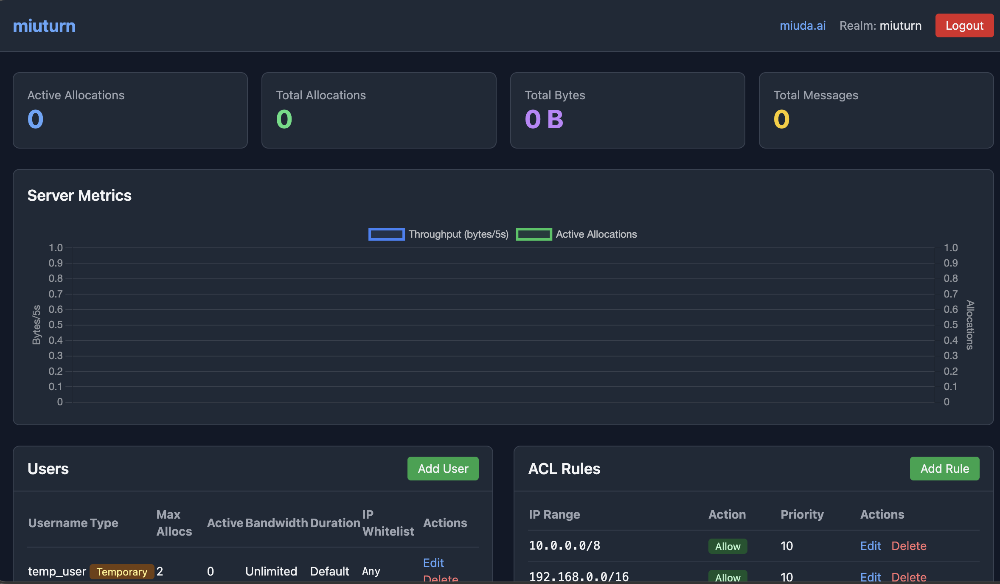

# miuturn

A high-performance TURN server written in Rust.



## Features

- **STUN/TURN Protocol Support**: RFC 5389/5766 compliant
- **Web Admin Console**: Built-in HTTP admin UI with real-time metrics dashboard
- **TURN REST API**: WebRTC credential generation with HMAC authentication
- **Shared-Secret Auth**: coturn-style ephemeral credentials (`expiry:user` + HMAC-SHA1), validated on the TURN port itself
- **User Management**: Fixed, temporary, and API key users with per-user limits
- **ACL Rules**: IP-based access control with priority ordering
- **Real-time Metrics**: Live throughput and active allocations charts
- **Config Persistence**: UI changes auto-save to TOML
- **Prometheus Metrics**: Built-in metrics export
- **TCP & UDP**: Dual protocol support

## Quick Start

### Binary

```bash
cargo build --release
./target/release/miuturn
```

### Docker

#### Using Pre-built Image (Recommended)

```bash
docker run -p 3478:3478 -p 3478:3478/udp -p 8080:8080 docker.cnb.cool/miuda.ai/miuturn:latest
```

#### Build from Source

```bash
docker build -t miuturn .
docker run -p 3478:3478 -p 3478:3478/udp -p 8080:8080 miuturn
```

## Configuration

Create `miuturn.toml`:

```toml
[server]
realm = "miuturn"
external_ip = "YOUR PUBLIC IP HERE"
relay_bind_ip = "0.0.0.0"
start_port = 49152
end_port = 65535
max_concurrent_allocations = 1000
max_bandwidth_bytes_per_sec = 10485760
max_allocation_duration_secs = 3600

[[server.listening]]
protocol = "udp"
address = "0.0.0.0:3478"

[[server.listening]]
protocol = "tcp"
address = "0.0.0.0:3478"

[http]
address = "0.0.0.0:8080"
# Admin console credentials (separate from TURN users)
admin_username = "admin"
admin_password = "changeme"
turn_rest_enabled = true
turn_rest_default_lifetime = 3600

[auth]
# Shared HMAC secret for ephemeral TURN credentials (see "Agent-issued tokens").
shared_secret = "your-secret-key"
# What happens when an established session outlives its token:
#   "renew"  - token only gates new Allocate requests (default)
#   "strict" - expired tokens are rejected on every request (coturn behavior)
#   "cap"    - allocation lifetime capped at the token expiry
expired_token_policy = "renew"

[[auth.users]]
username = "regular_user"
password = "userpass"
user_type = "fixed"
max_allocations = 5
bandwidth_limit = 1048576  # 1 MB/s limit
ip_whitelist = ["192.168.0.0/16"]

[[auth.users]]
username = "temp_user"
password = "temp123"
user_type = "temporary"
expires_at = 1735689600
max_allocations = 2

[auth.api_keys]
key1 = "admin"

[[auth.acl_rules]]
ip_range = "10.0.0.0/8"
action = "Allow"
priority = 10

[[auth.acl_rules]]
ip_range = "0.0.0.0/0"
action = "Deny"
priority = 1
```

`external_ip` is the relay address advertised back to clients.
`relay_bind_ip` is the local interface used to bind relay sockets. If omitted, it defaults to `0.0.0.0`. In NAT deployments, set `external_ip` to the public IP and keep `relay_bind_ip` as `0.0.0.0` (or a specific local interface IP if needed).

## Agent-Issued TURN Tokens (shared secret)

Typical WebRTC deployment: a JS client asks your **agent server** for a TURN
credential; only the agent server can mint valid ones, but **any client IP may
use the relay** with a minted credential.

miuturn supports this with coturn-style ephemeral credentials, and — unlike
minting over HTTP — the credentials are validated on the TURN port itself:

```
JS ──request──> agent server ──HMAC(secret)──> {username, credential}
JS ──TURN Allocate (any IP)──> miuturn:3478 ──verify HMAC──> relay
```

Configuration on the miuturn side:

```toml
[auth]
shared_secret = "same-secret-as-agent-server"
expired_token_policy = "renew"   # renew | strict | cap
```

- `username = "<unix-expiry-secs>:<user-id>"`
- `credential = hex(HMAC-SHA1(shared_secret, username))`

### Generating the shared secret

The secret must be **identical** on miuturn and the agent server, and long
enough to resist brute force (use ≥ 32 bytes of entropy; HMAC-SHA1 input can
be any length, but a short secret weakens the scheme). Generate it once and
distribute it out-of-band (config management / secret store — never commit it):

```bash
# OpenSSL (64 hex chars = 32 bytes of entropy)
openssl rand -hex 32

# Python
python3 -c "import secrets; print(secrets.token_hex(32))"

# Node.js
node -e "console.log(require('crypto').randomBytes(32).toString('hex'))"
```

Put the result in `miuturn.toml` and in the agent server's environment:

```toml
# miuturn.toml
[auth]
shared_secret = "9f86d081884c7d659a2feaa0c55ad015a3bf4f1b2b0b822cd15d6c15b0f00a08"
```

```bash
# agent server
export MIUTURN_SHARED_SECRET="9f86d081884c7d659a2feaa0c55ad015a3bf4f1b2b0b822cd15d6c15b0f00a08"
```

Rotation: tokens are self-validating HMACs, so there is no server-side token
store to purge. To rotate, deploy the new secret to the agent server and
miuturn (order does not matter — tokens minted with the old secret simply
stop validating on Allocate; established sessions are governed by
`expired_token_policy`). For zero-downtime rotation, run a second miuturn
instance with the new secret, cut traffic over, then retire the old one.

### Minting credentials on the agent server

The agent server mints credentials locally (Node.js example):

```js
const crypto = require("crypto");

const SECRET = process.env.MIUTURN_SHARED_SECRET; // same secret as auth.shared_secret

function issueTurnCredential(userId, ttlSecs = 3600) {
  const expiry = Math.floor(Date.now() / 1000) + ttlSecs;
  const username = `${expiry}:${userId}`;
  const credential = crypto
    .createHmac("sha1", SECRET)
    .update(username)
    .digest("hex");
  return {
    iceServers: [
      {
        urls: [
          "turn:turn.example.com:3478?transport=udp",
          "turn:turn.example.com:3478?transport=tcp",
        ],
        username,
        credential,
      },
    ],
    expiry,
  };
}
```

Equivalent minter in Python (e.g. for a Flask/FastAPI agent):

```python
import hashlib, hmac, os, time

SECRET = os.environ["MIUTURN_SHARED_SECRET"]

def issue_turn_credential(user_id: str, ttl_secs: int = 3600):
    expiry = int(time.time()) + ttl_secs
    username = f"{expiry}:{user_id}"
    credential = hmac.new(SECRET.encode(), username.encode(), hashlib.sha1).hexdigest()
    return {
        "username": username,
        "credential": credential,
        "expiry": expiry,
        "urls": [
            "turn:turn.example.com:3478?transport=udp",
            "turn:turn.example.com:3478?transport=tcp",
        ],
    }
```

Quick sanity check from a shell (server logs in the token username format):

```bash
SECRET="9f86d0..."; EXPIRY=$(( $(date +%s) + 600 )); USER="$EXPIRY:smoke-test"
echo "$USER -> $(printf '%s' "$USER" | openssl dgst -sha1 -hmac "$SECRET" -hex | awk '{print $NF}')"
```

Guidelines for TTL: keep it short (5–60 min). The token only gates the
initial Allocate; how long a session may live after expiry is controlled by
`expired_token_policy`.

The JS client puts the result straight into
`new RTCPeerConnection({ iceServers })`.

Notes:

- The shared secret never leaves the agent server and miuturn. Keep miuturn's
  HTTP port (8080) firewalled off from the public internet in this mode — the
  admin console is not needed for token minting.
- `http.turn_rest_secret` is a deprecated alias for `auth.shared_secret`;
  the `[auth]` key wins when both are set.
- Static users in `[[auth.users]]` continue to work alongside ephemeral
  credentials (exact username match takes precedence).
- There is **no global password fallback**: a username that is neither a
  configured user nor a valid `expiry:user` HMAC credential is rejected.

### Expired-token policies

`expired_token_policy` controls what happens to an established session once
its token expires:

| Policy   | Allocate after expiry | Refresh after expiry                  |
| -------- | --------------------- | ------------------------------------- |
| `renew`  | 401                   | allowed — sessions live until closed  |
| `strict` | 401                   | 401 — sessions die on next Refresh    |
| `cap`    | 401                   | allowed — lifetime clamped to expiry  |

### Reliability notes (long-running calls)

- Stale/expired nonces are answered with **438 Stale Nonce** plus a fresh
  nonce so clients retry transparently instead of tearing down.
- Channel bindings are refreshed by traffic in both directions (like coturn),
  so active media flows do not lose their channels after 600s.
- NAT rebinding (client source port change) still breaks a TURN session by
  design (5-tuple semantics); clients handle it via ICE restart.
- Restarting miuturn drops all in-memory allocations and nonces; clients
  re-allocate automatically.

## Admin Console

Access the web UI at `http://localhost:8080/console`

The admin console provides:
- **Real-time Metrics Dashboard**: Live chart showing throughput and active allocations
- **Statistics Cards**: Active/total allocations, bytes relayed, messages
- **User Management**: Add/edit/delete TURN users with bandwidth and duration limits
- **ACL Rules**: Manage IP-based access control with priority ordering

Configure admin credentials in `[http]` section:
```toml
[http]
admin_username = "admin"
admin_password = "changeme"
```

**Note**: Admin console credentials are separate from TURN service users in `[[auth.users]]`.

## API Endpoints

| Endpoint                   | Method | Description               |
| -------------------------- | ------ | ------------------------- |
| `/health`                  | GET    | Server health and stats   |
| `/metrics`                 | GET    | Prometheus metrics        |
| `/api/v1/stats`            | GET    | Detailed stats + users    |
| `/api/v1/users`            | POST   | Add user                  |
| `/api/v1/users`            | PUT    | Update user               |
| `/api/v1/users`            | DELETE | Delete user               |
| `/api/v1/acl`              | POST   | Add ACL rule              |
| `/api/v1/acl`              | PUT    | Update ACL rule           |
| `/api/v1/acl`              | DELETE | Delete ACL rule           |
| `/api/v1/turn-credentials` | POST   | Generate TURN credentials |

## Environment Variables

- `CONFIG`: Path to config file (default: `miuturn.toml`)

## License

MIT License - Powered by [miuda.ai](https://miuda.ai)
